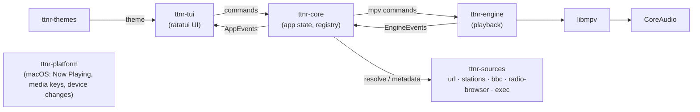

# Architecture

## Overview



One async runtime (tokio). Components talk through typed channels; the UI
never blocks on network or audio.

## Cargo workspace

| Crate | Responsibility |
|---|---|
| `ttnr` (bin) | CLI parsing (clap), wiring, config loading, logging setup |
| `ttnr-core` | Domain types (`Station`, `StreamDescriptor`, `NowPlaying`, `StreamInfo`), app state machine, `SourceRegistry`, metadata merging, sync offset, history |
| `ttnr-engine` | `Player` trait + `MpvPlayer` (libmpv) implementation; audio-only config; property observation → `EngineEvent`s |
| `ttnr-sources` | Source plugins (one module each) implementing `Source` / `MetadataProvider` |
| `ttnr-themes` | Theme model, TOML loader, built-in themes (embedded), glyph/case/colour transforms, colour-depth fallback |
| `ttnr-tui` | ratatui views, input handling, keymap; renders `AppState` through a `Theme` |
| `ttnr-platform` | macOS integration behind a trait: Now Playing/media keys (MediaPlayer via `objc2`), output device list/changes, sleep/wake; no-op impl for other OSes |

## Key abstractions (sketch — refine in code, record changes as ADRs)

```rust
/// A place stations come from (generic URL, BBC, a directory, a script…).
#[async_trait]
pub trait Source: Send + Sync {
    fn id(&self) -> &'static str;                       // "bbc", "url", …
    fn capabilities(&self) -> SourceCaps;               // browse? search? metadata?
    async fn list(&self, q: &ListQuery) -> Result<Vec<Station>>;
    /// Turn a station into something playable *now*. Called at play time,
    /// never cached forever: stream URLs change.
    async fn resolve(&self, st: &Station, ctx: &ResolveCtx) -> Result<StreamDescriptor>;
    /// Force re-discovery (bypass caches), e.g. after a 403/404 or `ttnr refresh`.
    async fn refresh(&self, st: &Station) -> Result<StreamDescriptor> { … }
    /// Optional external now-playing provider for this station.
    fn metadata(&self, st: &Station) -> Option<Box<dyn MetadataProvider>> { None }
}

pub struct StreamDescriptor {
    pub urls: Vec<StreamUrl>,        // ordered candidates (quality / region fallbacks)
    pub headers: Vec<(String, String)>,
    pub resolved_at: SystemTime,
    pub ttl: Option<Duration>,
    pub resolver: ResolverTrace,     // which strategy produced it (shown in debug)
}

#[async_trait]
pub trait MetadataProvider: Send {
    /// Stream of NowPlaying updates; provider owns its polling cadence.
    async fn run(self: Box<Self>, tx: Sender<MetadataUpdate>) -> Result<()>;
}

pub trait Player {               // implemented by MpvPlayer
    fn play(&mut self, d: &StreamDescriptor) -> Result<()>;
    fn stop(&mut self); fn pause(&mut self, on: bool);
    fn set_volume(&mut self, pct: f32); fn set_device(&mut self, dev: Option<&str>);
    fn take_events(&mut self) -> Option<EngineEvents>; // once; Loading, Playing, Buffering, Error{kind}, Eof… (ADR-010)
}
```

## Stream resolution and refresh (applies to every source)

Stream URLs are **resolved at play time** through an ordered chain of
strategies, with a small on-disk cache:

1. **Cache** — last good URL if younger than its TTL.
2. **Discovery** — the source's authoritative lookup. For BBC: the same
   machine-readable endpoint BBC's own web player uses to find live streams
   (identify and verify it in M4; prefer JSON APIs over HTML scraping).
3. **Patterns** — known URL templates (e.g. BBC's Akamai HLS layout with
   region `ww`/`uk` and bitrate variants), probed in order.
4. **Override** — a URL pinned by the user in `stations.toml`.

The engine reports `EngineEvent::Error(Http403 | Http404 | Unreachable)`;
core then calls `Source::refresh()` **once**, retries, and only then shows
an error. `ttnr refresh [station]` forces re-discovery from the CLI.
Every resolution records a `ResolverTrace` (visible with `--debug`).

## Engine: libmpv configuration (audio-only)

`vid=no`, `video=no`, `ao=coreaudio`, `audio-display=no`, `ytdl=no`,
`terminal=no`, `input-default-bindings=no`, `osc=no`, cache/readahead
tuned for live streams, `audio-channels=auto-safe` (system's preferred device layout; ADR-009),
optional `audio-exclusive` / sample-rate matching from config.
Observe properties: `metadata`, `media-title`, `audio-codec-name`,
`audio-params`, `audio-bitrate`, `demuxer-cache-state`, `paused-for-cache`,
`audio-device-list`, `current-ao`. Verify every option name against the
mpv manual for the installed version (log in RESEARCH.md).

## Metadata pipeline

Sources of truth, merged by priority per field:
external provider (e.g. BBC) > timed ID3 > ICY. Each update carries its
timestamp; core applies the configured sync offset before showing it.
A provider failure degrades to "programme only" or "station only", silently
retrying with backoff.

## Themes

Pure data (TOML) + a `ThemeRenderer` that applies: case transform, glyph
substitution (e.g. box-drawing → ASCII), palette with depth fallback, logical
width/centring, number format, banner/prompt templates, effects. Views never
hard-code colours or glyphs. See THEMES.md.

## Config & files

- `~/.config/ttnr/config.toml`, `stations.toml`, `themes/`
- cache: `~/.cache/ttnr/resolve.json`
- logs: `~/.local/state/ttnr/ttnr.log` (rotated)
- control socket: `$TMPDIR/ttnr-$UID.sock` (JSON lines)

## Testing strategy

- Unit: parsers (playlists, ICY, BBC JSON), resolver chains (with fake
  HTTP via fixtures), metadata merging, theme transforms.
- Snapshot: each view × each built-in theme × 3 sizes (`insta`).
- Format matrix: `scripts/gen-fixtures.zsh` uses `ffmpeg` to generate short
  test files (MP3, AAC-LC, HE-AAC, Opus, Vorbis, FLAC 24/96, ALAC, AC-3 5.1,
  E-AC-3 7.1, PCM) and an HLS sample; tests play them via `MpvPlayer` with
  `ao=null` and assert reported `StreamInfo`.
- Network smoke tests (`cargo test -- --ignored`): real BBC resolution and
  now-playing fetch.
