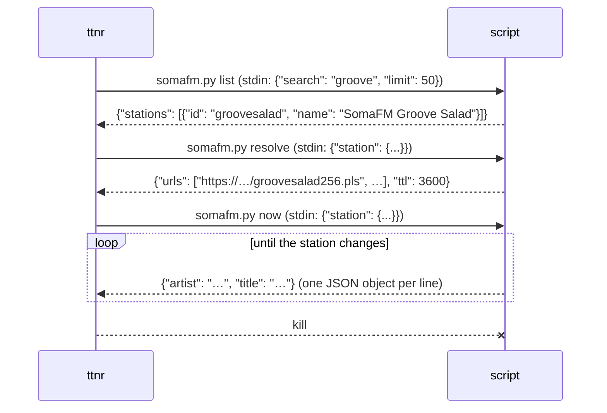

# Sources

A *source* tells ttnr which stations exist and how to play them. Built in:
`url` (any URL or file), `stations` (your `stations.toml`), `bbc`,
`radio-browser` (the radio-browser.info directory). Anything else can be
added as an **external command** – a script in any language – without
recompiling ttnr (the `exec` protocol below, ADR-041).

## Adding a script source

1. Write a program that understands the three verbs below (start from
   `examples/sources/somafm.py`, 32 lines).
2. Register it in `~/.config/ttnr/config.toml` (before any `[keys]` table):

   ```toml
   [sources.somafm]
   command = ["~/bin/somafm.py"]      # program + arguments
   ```

   The table name (`somafm`) becomes the source id. It may not be a
   built-in id. The program path may start with `~/`; a path with a `/`
   that is not absolute is relative to the config directory; a bare name
   (`python3`) is looked up on `PATH`.
3. Use it:
   - the TUI adds the source's stations to the station list (`s`);
   - `ttnr search <text> --source somafm` searches it and prints a
     `stations.toml` entry;
   - in `stations.toml`, `source = "somafm"` with the station's `id`.

## The protocol

ttnr runs `command… <verb>`, writes one JSON request to the program's
stdin and closes it, then reads the program's stdout.



| Verb | Request (stdin) | Answer (stdout) |
|---|---|---|
| `list` | `{"search": "text" or null, "limit": n or null}` | `{"stations": [{"id": "…", "name": "…", "url": "…"?, "params": {"k": "v"}?}]}` – `search` null = all stations |
| `resolve` | `{"station": {"id", "name", "url", "params"}}` | `{"urls": ["…", …], "headers": {"Name": "value"}?, "ttl": seconds?}` – URLs in order of preference (mirrors); playlists (`.pls`, `.m3u`) and HLS are fine |
| `now` (optional) | `{"station": {…}}` | JSON lines, one per change: `{"artist"?, "title"?, "programme"?, "album"?, "artwork_url"?}`; keep running |

Rules:

- **Unsupported verb:** exit with code **64** (or print
  `{"unsupported": true}`). Without `resolve`, the station's own `url`
  plays; without `now`, only in-stream titles (ICY/ID3) are shown.
- **Errors:** exit non-zero; the first line of stderr is shown to the user.
  `{"error": "message"}` on stdout works too.
- **Time:** `list` and `resolve` must answer within 15 s.
- **`now`** runs as long as the station plays; ttnr kills it when the
  station changes or ttnr quits. Exit when stdout is closed (a write fails
  with a broken pipe) so nothing lingers if ttnr was killed hard.
- Station ids must be unique within the source and non-empty; entries
  without an id are ignored. All JSON is UTF-8.
- Now-playing from `now` is treated like other external metadata: shown
  at once (or after the source's sync offset, `[sync_offset]` in
  `config.toml`).
